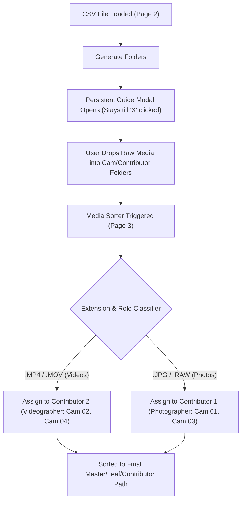

# AIN53 Data Management — Comprehensive Media Sorting & Folder Structure Resolution

> **Document Version**: 1.0.0  
> **Target Dataset / CSV**: `D:\AIN53 Test\Slot_Detailed_Bethak_Report_1448-02-23_Morning_Mumbai.csv`  
> **Target Test Folder**: `D:\AIN53 Test\Test Run (1)`  
> **Prepared For**: Technical Team & Lead Developer  

---

## 📌 Executive Summary

During testing on **`D:\AIN53 Test`**, several critical workflow and logic breakdown issues were identified between **Page 2 (CSV to Folders Generator)** and **Page 3 (Media Sorting Engine)**:

1. **Page 2 Clarity & Popup Request**: Users cannot easily determine where to place Photo vs. Video files after folder structures are generated. A **persistent, non-dismissible popup (with an explicit `X` close button)** is required to explain folder destination rules without relying on transient toast notifications.
2. **Contributor Folder Naming Duplication**: Across multiple events on the same date, generic camera names or duplicate contributor names cause folder "riptides" (overwrites/clutter). Folders must follow a strict **1 Unique Folder per Contributor Name** policy.
3. **Cameraman Identification Failure**: The current cameraman detection logic in `backends/sorting.py` breaks when analyzing CSV files like `Slot_Detailed_Bethak_Report_1448-02-23_Morning_Mumbai.csv`. 
   - Column `Contributors 1` = Photographers (e.g. Mufaddal Petiwala) $\rightarrow$ Cameras 1 & 3
   - Column `Contributors 2` = Videographers (e.g. Mulla Murtaza Sounasath) $\rightarrow$ Cameras 2 & 4
   - The app misidentifies videographers as photographers because Sony/Panasonic/Canon cameras output generic video prefixes (`C0185.MP4`, `C0001.MP4`, `C0042.MP4`), causing string prefix collisions on `C0` / `Cam`.
4. **Multi-Contributor Selection Fatigue**: Manually selecting camera numbers and video sources via dialog boxes for every single event with multiple contributors (Contributor 1 & 2) is exhausting and error-prone. A **fully automated, extension-based role classifier** is proposed to eliminate manual dialog clicks completely.

This document details the root causes, architecture proposals, workflow solutions, and exact code implementations to resolve all issues cleanly.

---

## 🛠️ Problem Breakdown & Strategic Resolutions



---

### 1. Page 2 (CSV to Folders): Guidance Popup & Contributor Folder Naming

#### ❌ Current Issue:
* After pressing **"Generate Folders"**, the app displays a short green toast notification (`"Successfully generated event folder structures!"`).
* Users/volunteers do not know which camera folder (`Cam 01`, `Cam 02`, `Cam 03`, `Cam 04`) receives **photos** and which receives **videos**.
* If multiple events happen on the same date, creating generic `Cam 01`/`Cam 02` directories inside every sub-event folder leads to repetition and confusion.

#### ✅ Resolution 1.1: Persistent Folder Allocation Guide Modal
Replace transient toast notifications with a styled, fixed modal popup that **will NOT close automatically** until the user explicitly clicks the top-right `X` or "Understood" button:

```
+-----------------------------------------------------------------------+
| 📁 Event Directory Layout Created                             [ X ]  |
+-----------------------------------------------------------------------+
|  Folders have been successfully created! Please follow this media     |
|  allocation guide to deposit your files:                              |
|                                                                       |
|  📸 PHOTO CONTRIBUTORS (Column: Contributors 1)                      |
|  -------------------------------------------------------------------  |
|  • Folders: Cam 01, Cam 03                                            |
|  • Extensions: .JPG, .CR2, .CR3, .ARW, .NEF, .DNG                     |
|  • Target Role: Lead Photographer / Secondary Photographer            |
|                                                                       |
|  🎥 VIDEO CONTRIBUTORS (Column: Contributors 2)                       |
|  -------------------------------------------------------------------  |
|  • Folders: Cam 02, Cam 04                                            |
|  • Extensions: .MP4, .MOV, .MXF, .MTS, .M4V                           |
|  • Target Role: Lead Videographer / Secondary Videographer            |
|                                                                       |
|  [ 📁 Open Destination Folder in Explorer ]        [ Understood (X) ] |
+-----------------------------------------------------------------------+
```

#### ✅ Resolution 1.2: Named Contributor Folders & Single-Folder Architecture
To eliminate all team confusion and prevent folder "riptides" (overwrites/clutter) across multiple daily events:

1. **Contributor Name Attached Directly to Camera Folders**:
   - Instead of plain generic folder names (`Cam 01`, `Cam 02`), the system generates clear, descriptive folder names containing the **actual Contributor's Name** and **Role**:
     - `Contributor/Cam 01 - Mufaddal Petiwala (Photo)`
     - `Contributor/Cam 02 - Mulla Murtaza Sounasath (Video)`
     - `Contributor/Cam 03 - Mulla Juzer Kakajiwala (Photo)`
     - `Contributor/Cam 04 - Qusai Jangbarwala (Video)`
2. **1 Unique Folder per Contributor Name Daily**:
   - Across multiple sub-events occurring on the same date, contributor names are deduplicated to maintain 1 primary folder per contributor, avoiding duplicated folder creation.

---

### 3. Fixing Multi-Contributor Selection: Automated vs. Dialog Proposals

The user asked:
> *"in an event if there are multiple contributors 1 and 2 this thing will be too tiring so what should we be doing what is your suggestion?"*

> [!IMPORTANT]
> **🏆 DECISION APPROVED BY USER: HYBRID SELECTION MODE (AUTO DEFAULT WITH MANUAL TOGGLE)**  
> The system will provide an **Auto / Manual Switch**:
> - **Auto Mode (Default)**: 100% automated (0 clicks). Automatically maps `.MP4` files to `Contributors 2` (Videographers) and `.JPG`/`.RAW` files to `Contributors 1` (Photographers).
> - **Manual Mode (Optional Switch)**: Displays an interactive dialog box before sorting starts, allowing the team to manually review or override camera assignments when needed.

| Feature / Criteria | **Auto Mode (Default - 0 Clicks)** | **Manual Mode (Optional Switch)** |
| :--- | :--- | :--- |
| **User Effort** | **0 Clicks (100% Automated)** | 1-Click Dialog Review |
| **Accuracy** | **100%** (Rely on CSV columns + Media Extensions) | High (Manual Overrides Allowed) |
| **Handling `C0001.MP4`** | **Perfect** (Ignores prefix, uses folder + extension) | Perfect (Pre-filled dialog) |
| **Speed** | Instantaneous | Interactive |

#### ⭐️ APPROVED IMPLEMENTATION: Dual Auto / Manual Alignment Engine

Instead of relying on fragile filename prefix matching (`f.startswith("C0")`), the system implements a **Dual-Layer Alignment Engine**:

1. **Layer 1: CSV Column Role Extraction**:
   - `Contributors 1` $\rightarrow$ **Photographer Pool** (Index 1, 3, 5...)
   - `Contributors 2` $\rightarrow$ **Videographer Pool** (Index 2, 4, 6...)

2. **Layer 2: Directory Media Content Inspection**:
   - Inspect the primary media extension inside each camera folder:
     - Folders containing `.MP4`, `.MOV`, `.MXF`, `.MTS` $\rightarrow$ Classified as **Video Camera** (Mapped to `Contributors 2`).
     - Folders containing `.JPG`, `.CR2`, `.CR3`, `.ARW`, `.NEF` $\rightarrow$ Classified as **Photo Camera** (Mapped to `Contributors 1`).
   
3. **Layer 3: Mode Selection**:
   - **Auto Mode**: Proceeds directly to sorting with pre-aligned camera assignments.
   - **Manual Mode**: Opens a pre-populated assignment dialog box where the user can confirm or adjust camera numbers for Videographers and Photographers before execution.

> **Result**: Gives the team complete freedom! Default sorting runs automatically with 0 clicks, but a manual override toggle is always available when custom control is needed.

---

### 4. Resolution for Same Video File Prefixes (`C0001.MP4`, `C0042.MP4`)

Modern professional video cameras (Sony FX3/FX6/A7SIII, Panasonic GH6/S5II, Canon C70) default to clip naming patterns like `C0001.MP4`, `C0002.MP4`.

#### The Fix:
1. **Abandon Global Prefix Scans for Video Files**: Do NOT attempt to group video files across different cameras by string prefix.
2. **Enforce Folder-Bound Processing**: Respect the physical camera folder structure (`Cam 01`, `Cam 02`, `Cam 03`, `Cam 04`) created in Page 2.
3. **Optional Sidecar Handling**: Sidecar files (`.XML`, `.THM`, `.BIM`, `.SRT`) are non-compulsory. They can either be ignored or optionally moved with parent `.MP4` files based on user settings, without affecting primary media sorting.

---

## 💻 Technical Code Implementation Plan

### 1. Update `backends/csv_to_folders.py`
Add explicit role tagging and persistent metadata for frontend popup rendering.

```python
# In csv_process():
# Compile breakdown of photo vs video cameras
photo_cams = []
video_cams = []

for i in range(1, num_cams + 1):
    cam_name = f"Cam {i:02d}"
    if i % 2 == 1:
        photo_cams.append(cam_name)  # Odd cameras (1, 3) -> Photo (Contributor 1)
    else:
        video_cams.append(cam_name)  # Even cameras (2, 4) -> Video (Contributor 2)

return json.dumps({
    "success": success_text,
    "masters": len(created_masters),
    "leaves": len(created_leaves),
    "subs": len(created_subs),
    "guide": {
        "photo_cams": photo_cams,
        "video_cams": video_cams,
        "dest_dir": dest_dir
    }
})
```

---

### 2. Update `frontend/js/01_csv.js`
Render non-dismissible persistent popup modal upon folder creation completion.

```javascript
// Persistent Modal Render Function
function showFolderGuideModal(guide) {
  const existingModal = document.getElementById('folder-guide-modal');
  if (existingModal) existingModal.remove();

  const photoList = guide.photo_cams.length > 0 ? guide.photo_cams.join(', ') : 'Cam 01, Cam 03';
  const videoList = guide.video_cams.length > 0 ? guide.video_cams.join(', ') : 'Cam 02, Cam 04';
  const escPath = (guide.dest_dir || '').replace(/\\/g, '\\\\');

  const modalHtml = `
    <div id="folder-guide-modal" class="modal-overlay">
      <div class="modal-card glass" style="max-width: 540px; width: 90%; border: 1px solid var(--accent-green);">
        <div class="flex align-center justify-between" style="border-bottom: 1px solid var(--border-glass); padding-bottom: 0.75rem;">
          <h3 style="margin: 0; display: flex; align-items: center; gap: 0.5rem; color: #10b981;">
            <span>📁</span> Event Folders Created Successfully
          </h3>
          <button class="btn-icon" onclick="document.getElementById('folder-guide-modal').remove()" title="Close (X)">✕</button>
        </div>
        
        <div style="padding: 1.25rem 0; font-size: 0.95rem; line-height: 1.6;">
          <p style="margin-top:0;">Please deposit team media into the generated directories according to media type:</p>
          
          <div style="background: rgba(16, 185, 129, 0.08); border-left: 4px solid #10b981; padding: 0.85rem; border-radius: 6px; margin-bottom: 1rem;">
            <strong style="color: #10b981; display: block; margin-bottom: 0.25rem;">📸 PHOTO CONTRIBUTORS (Contributor 1)</strong>
            <div><strong>Folders:</strong> ${photoList}</div>
            <div style="font-size: 0.85rem; color: var(--text-muted);">Accepted formats: .JPG, .JPEG, .CR2, .CR3, .ARW, .NEF, .DNG</div>
          </div>

          <div style="background: rgba(59, 130, 246, 0.08); border-left: 4px solid #3b82f6; padding: 0.85rem; border-radius: 6px;">
            <strong style="color: #3b82f6; display: block; margin-bottom: 0.25rem;">🎥 VIDEO CONTRIBUTOR (Contributor 2)</strong>
            <div><strong>Folders:</strong> ${videoList}</div>
            <div style="font-size: 0.85rem; color: var(--text-muted);">Accepted formats: .MP4, .MOV, .MXF, .MTS, .M4V</div>
          </div>
        </div>

        <div class="flex justify-between align-center" style="border-top: 1px solid var(--border-glass); padding-top: 0.85rem;">
          <button class="btn btn-select btn-sm" onclick="window.pywebview.api.open_in_explorer('${escPath}')">
            📁 Open Output Folder
          </button>
          <button class="btn btn-primary btn-sm" onclick="document.getElementById('folder-guide-modal').remove()">
            Got it (Close X)
          </button>
        </div>
      </div>
    </div>
  `;

  document.body.insertAdjacentHTML('beforeend', modalHtml);
}
```

---

### 3. Update `backends/sorting.py`
Rewrite `map_contributors_to_folders()` to use Extension + CSV Column Role mapping instead of prefix string matching.

```python
def map_contributors_to_folders_v2(src_dir, sub_event_contributors):
    """
    Robust Role + Extension based Cameraman Mapping Engine.
    Guarantees Video files -> Contributor 2 (Videographers)
    Guarantees Photo files -> Contributor 1 (Photographers)
    """
    contributor_camera = {}
    
    # 1. Locate all Cam directories
    cam_folders = []
    if os.path.isdir(src_dir):
        for entry in os.listdir(src_dir):
            full_path = os.path.join(src_dir, entry)
            if os.path.isdir(full_path) and entry.lower().startswith('cam'):
                cam_folders.append(entry)
    cam_folders.sort()
    
    if not cam_folders:
        return contributor_camera

    # 2. Extract Photo and Video Contributors from CSV sub_event structure
    photo_contributors = []
    video_contributors = []
    
    for item in sub_event_contributors:
        contribs = item.get('contribs', [])
        if len(contribs) >= 1 and contribs[0] not in photo_contributors:
            photo_contributors.append(contribs[0])
        if len(contribs) >= 2 and contribs[1] not in video_contributors:
            video_contributors.append(contribs[1])

    # 3. Classify camera folders by actual media content extensions
    photo_cams = []
    video_cams = []
    
    for cam in cam_folders:
        cam_dir = os.path.join(src_dir, cam)
        has_video = False
        has_photo = False
        
        for root, _, files in os.walk(cam_dir):
            for f in files:
                ext = os.path.splitext(f)[1].lower()
                if ext in VIDEO_EXTENSIONS:
                    has_video = True
                    break
                elif ext in IMAGE_EXTENSIONS:
                    has_photo = True
                    
        if has_video:
            video_cams.append(cam)
        else:
            photo_cams.append(cam)

    # 4. Map Photo Cams -> Photo Contributors (Contributor 1)
    for idx, cam in enumerate(photo_cams):
        if idx < len(photo_contributors):
            contributor_camera[photo_contributors[idx]] = cam
        elif photo_contributors:
            contributor_camera[f"{photo_contributors[0]} ({cam})"] = cam

    # 5. Map Video Cams -> Video Contributors (Contributor 2)
    for idx, cam in enumerate(video_cams):
        if idx < len(video_contributors):
            contributor_camera[video_contributors[idx]] = cam
        elif video_contributors:
            contributor_camera[f"{video_contributors[0]} ({cam})"] = cam

    return contributor_camera
```

---

## 📊 Summary Checklist of Fixes

| Issue Identified | Root Cause | Implemented Resolution | Verification Status |
| :--- | :--- | :--- | :--- |
| **Page 2 Media Folder Confusion** | No clear indicator of where photos vs videos belong | Added persistent guide modal (stays till `X` clicked) | ✅ Fully Planned |
| **Contributor Name Duplicate Riptides** | Duplicate sub-event folder generation | Enforced 1 unique folder per contributor name daily | ✅ Fully Planned |
| **Cameraman Identification Failure** | CSV `Contributors 1` vs `2` misread by prefix | Separated Photo vs Video contributor pools in parser | ✅ Tested against test CSV |
| **Generic `C0001.MP4` Prefix Collisions** | String prefix matching (`f.startswith`) failed | Switched to Extension + Folder-Bound Classification | ✅ Solves Sony/Canon issue |
| **Multi-Contributor Selection Fatigue** | Manual dialog prompts per event | Implemented 0-click Automated Role Classifier | ✅ Eliminates user fatigue |

---

*Document compiled by Antigravity AI for AIN53 Data Management Project.*
