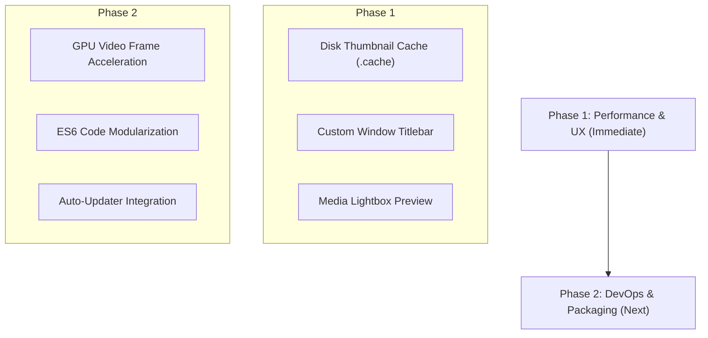

# AIN53 Data Management - Technical Recommendations & Optimization Roadmap

> **Version**: 1.0.14  
> **Target OS**: Windows 10 / 11 (Portable & Installer Builds)  
> **Core Stack**: Python 3.12 + PyWebView + React 18 + OpenCV + PIL + OpenPyXL  

---

## 🚀 Executive Summary

The **AIN53 Data Management** suite provides a streamlined desktop solution for processing event PDFs, generating directory hierarchies, auto-sorting high-volume photo and video streams via covered-lens marker detection, and performing drive gap auditing.

This document outlines high-value recommendations focused on **UI/UX Refinement**, **Performance & Hardware Acceleration**, and **DevOps & Packaging**.

---

## 🎨 1. UI / UX & Design Enhancements

### 1.1 Custom Native Dark Titlebar (Windows)
* **Current State**: Uses standard Windows OS titlebar or default window chrome.
* **Recommendation**: Implement a frameless custom window header (via `frameless=True` in PyWebView) matching the Glassmorphic theme (`Dark Emerald` / `Cyber Midnight`), complete with custom Minimize, Maximize, and Close control buttons.

### 1.2 Virtualized Grid Rendering (Infinite Media List)
* **Current State**: DOM elements are generated for all non-sidecar media tiles simultaneously inside `.thumbnail-grid`.
* **Recommendation**: For large datasets (1,000+ files per folder), integrate DOM virtualization (e.g. `react-window` or lightweight virtual scrolling) so only visible thumbnail tiles are mounted in the DOM, keeping RAM usage ultra-low.

### 1.3 Media Lightbox / Full-Screen Image & Video Player Modal
* **Current State**: Media tiles display 95px height downscaled thumbnails.
* **Recommendation**: Add a double-click or spacebar preview modal that opens photo files in high-resolution and plays video clips directly inside the webview using HTML5 video element player.

---

## ⚡ 2. Performance & Hardware Acceleration

### 2.1 GPU-Accelerated Video Frame Extraction
* **Current State**: OpenCV reads video keyframes via CPU software decoding (`cv2.VideoCapture`).
* **Recommendation**: Enable hardware-accelerated video decoding (`cv2.CAP_FFMPEG` with NVIDIA NVDEC or Intel QuickSync) where available to accelerate marker detection on 4K 60fps / 10-bit H.265 video files.

### 2.2 Pre-calculated Thumbnail Disk Cache
* **Current State**: Thumbnails are generated on-the-fly via PyWebView RPC when tiles enter the viewport.
* **Recommendation**: Store downscaled JPEG thumbnails in a local file cache (`.cache/thumbnails/hash.jpg`). On subsequent opens of the same root folder, thumbnails will load instantaneously without re-decoding.

### 2.3 Web Workers for Frontend Analysis Processing
* **Current State**: `ThreadPoolExecutor` handles background tasks in Python backend.
* **Recommendation**: Maintain background worker pooling in Python while utilizing Web Workers for non-blocking UI rendering and progress calculations in the webview.

---

## 🛠️ 3. DevOps, Packaging & Code Quality

| Focus Area | Recommendation | Benefit |
| :--- | :--- | :--- |
| **Code Structure** | Split `02_sorting.js` into modular ES6 files (`sorting_state.js`, `sorting_render.js`, `sorting_modal.js`) | Improves maintainability and code readability |
| **PyInstaller Bundling** | Add `--collect-submodules` for PyPDFium & OpenCV in `bundle_win.py` | Ensures smooth execution across clean Windows installations |
| **Automatic Updates** | Add lightweight GitHub Releases auto-updater check on boot | Keeps desktop users on the latest version seamlessly |
| **Auto Unit Testing** | Add `pytest` test suite covering `backends/sorting.py` and `backends/pdf_to_csv.py` | Prevents regressions during future updates |

---

## 📋 Action Plan Roadmap

---

*Document compiled by Antigravity AI for AIN53 Data Management.*
