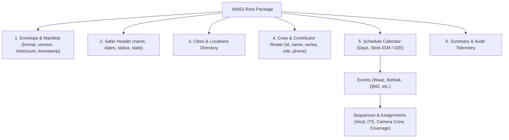

# AIN53 Safar Sync Package (.AIN53) File Specification & Integration Guide

**Document Version:** 1.0.0  
**Status:** Official Standard  
**Target Systems:** AIN53 Desktop Coordinator Application, Central Web Platform, Field Viewers, Sync Endpoints  
**File Extension:** `.AIN53` (Alternative fallback: `.json`)  
**MIME Type:** `application/x-ain53+json` (Fallback: `application/json`)  
**Character Encoding:** `UTF-8`

---

## Table of Contents
1. [Executive Summary & Purpose](#1-executive-summary--purpose)
2. [File Format Architecture](#2-file-format-architecture)
3. [Complete Schema & Data Contract](#3-complete-schema--data-contract)
4. [Field-by-Field Reference](#4-field-by-field-reference)
5. [Website Reading & Ingestion Guide (Detailed Step-by-Step)](#5-website-reading--ingestion-guide-detailed-step-by-step)
   - [5.1 Client-Side File Intake (HTML5 & Drag-and-Drop)](#51-client-side-file-intake-html5--drag-and-drop)
   - [5.2 Client-Side Parsing & Validation Engine (TypeScript / JavaScript)](#52-client-side-parsing--validation-engine-typescript--javascript)
   - [5.3 React Hook Integration (`useAin53Sync`)](#53-react-hook-integration-useain53sync)
   - [5.4 Web Backend Ingestion Pipelines](#54-web-backend-ingestion-pipelines)
     - [Node.js / Express / Next.js Implementation](#nodejs--express--nextjs-implementation)
     - [Python / FastAPI / Django Implementation](#python--fastapi--django-implementation)
     - [PHP / Laravel Implementation](#php--laravel-implementation)
   - [5.5 Database Upsert & Reconciliation Logic](#55-database-upsert--reconciliation-logic)
6. [Desktop Application Generation & Import Logic](#6-desktop-application-generation--import-logic)
7. [Integrity, Checksums & Validation Rules](#7-integrity-checksums--validation-rules)
8. [Complete Sample `.AIN53` Payload](#8-complete-sample-ain53-payload)

---

## 1. Executive Summary & Purpose

During Safar events (such as Waaz, Bethak, QMZ, Majlis, Namaz, Ziyarat, Isteqbal, and Wada), field coordinators configure schedules, sequence numbers, host family assignments, and photography/videography crew series assignments on local coordinator machines. Often, field venues have limited or intermittent internet connectivity.

The **`.AIN53`** file format is designed to solve this synchronization problem:
* **Self-Contained Data Bundle:** Contains all metadata, cities, crew directories, date schedules, event configurations, and granular ceremony sequences (down to host names, ITS numbers, contact numbers, camera series, and coverage status).
* **Cross-Platform Interoperability:** Can be exported from the desktop application, stored on flash drives, sent over messaging platforms, and uploaded directly to the central **AIN53 Website**.
* **Idempotent Synchronization:** Designed so that re-uploading an updated `.AIN53` file seamlessly reconciles, updates, or merges data without corrupting existing records.
* **Inspectable & Human-Readable:** Formatted as structured JSON with UTF-8 encoding, allowing it to be verified in lightweight field viewer tools without requiring a database engine.

---

## 2. File Format Architecture

An `.AIN53` package is composed of six primary layers:



### High-Level Envelope
```json
{
  "$schema": "https://ain53.org/schemas/safar-sync-v1.json",
  "format": "AIN53_SAFAR_SYNC_PACKAGE",
  "version": "1.0.0",
  "generator": {
    "app": "AIN53 Data Management Desktop",
    "version": "1.5.0",
    "platform": "win32",
    "exported_at": "2026-09-27T16:45:00.000Z"
  },
  "checksum": "sha256:d41d8cd98f00b204e9800998ecf8427e...",
  "safar": { /* Safar Core Attributes */ },
  "cities": [ /* Cities List */ ],
  "crew": [ /* Crew & Contributor Directory */ ],
  "schedule": [ /* Dates, Slots, Events & Sequences */ ],
  "metrics": { /* Verification Counters */ }
}
```

---

## 3. Complete Schema & Data Contract

### 3.1 TypeScript Type Definitions
Web applications interacting with `.AIN53` should use the following authoritative TypeScript definitions:

```typescript
export interface Ain53Package {
  $schema?: string;
  format: 'AIN53_SAFAR_SYNC_PACKAGE';
  version: '1.0.0';
  generator: Ain53GeneratorMeta;
  checksum?: string;
  safar: Ain53SafarMeta;
  cities: Ain53City[];
  crew: Ain53CrewMember[];
  schedule: Ain53DaySchedule[];
  inventory_reports?: Ain53SlotInventoryReport[]; // All uploaded inventory reports with 1000% Excel replicas
  inventory_files?: Record<string, Ain53SlotInventoryReport>; // Map of full Excel replicas by filename
  metrics: Ain53PackageMetrics;
}

export interface Ain53GeneratorMeta {
  app: string;
  version: string;
  platform?: string;
  exported_at: string; // ISO 8601 UTC
  exported_by?: string;
}

export interface Ain53SafarMeta {
  id?: number | string;
  name: string;
  scope: 'FULL_SAFAR' | 'DATE_SLOT' | 'SINGLE_DAY';
  target_date?: string; // Set when exporting a single day (YYYY-MM-DD)
  target_slot?: 'Morning' | 'Evening' | '01M' | '02E';
  created_at?: string;
  notes?: string;
}

export interface Ain53City {
  id: number;
  name: string;
  teams_required?: number;
  core_teams?: any[];
}

export interface Ain53CrewMember {
  id: number;
  name: string;
  role: 'photographer' | 'videographer' | 'coordinator' | 'support' | string;
  series: string; // Camera Series e.g. "A", "B", "C", "P1"
  phone?: string;
  email?: string;
  its?: string;
  safar_name?: string;
  city_id?: number;
  active?: boolean;
}

export interface Ain53DaySchedule {
  date: string; // Hijri date: YYYY-MM-DD (e.g. "1447-09-01")
  gregorian_date?: string; // YYYY-MM-DD
  day_label?: string; // e.g. "Youm al-Juma"
  slots: Ain53Slot[];
}

export interface Ain53Slot {
  slot_code: '01M' | '02E';
  slot_name: 'Morning' | 'Evening';
  start_time?: string; // e.g. "09:30 AM" or "09:30"
  end_time?: string;   // e.g. "01:30 PM"
  status: 'CREATED' | 'IN_PROGRESS' | 'COMPLETED';
  event_ended?: boolean;
  event_end_time?: string;
  inventory_report?: Ain53SlotInventoryReport | null;
  events_count: number;
  sequences_count: number;
  events: Ain53Event[];
}

export interface Ain53SlotInventoryReport {
  uploaded?: boolean;
  filename: string;                                           // Must end with _Inventory_Report.xlsx / _Invertory_Report.xlsx
  file_size?: number;                                         // Raw file size in bytes
  total_found: number;                                        // Total verified files located on drives
  total_missing: number;                                      // Total missing/unrecorded sequence files
  uploaded_at?: string;                                       // ISO timestamp of upload/verification
  file_base64?: string;                                       // Raw binary of original .xlsx file (Base64 encoded) for 100% exact replica & direct download

  // Audit Metrics
  metrics?: {
    total_found: number;
    total_missing: number;
    total_cameras: number;
    total_folders: number;
    total_missing_files: number;
    total_contributor_files: number;
    total_issues: number;
  };

  // 5 Exact Structured Replica Sheets
  missing_files?: Array<{ folder_path: string; file_name: string; status: string; camera_type: string }>;
  folder_structure?: Array<{
    column_index?: number;
    folder_path: string;
    contributor: string;
    total_files: number;
    files: Array<{ file_name: string; extension: string; camera_type: string }>;
    extension_counts: Record<string, number>;
  }>;
  cameras?: Array<{
    camera: string;
    files_count: number;
    total_found: number;
    total_missing: number;
    files: Array<{ folder: string; file: string; status: string; camera_type: string }>;
  }> | Record<string, any>;
  contributors?: Array<{ folder_path: string; file_name: string }>;
  issues?: Array<{ path: string; type: string; description: string }>;

  // Containerized Sheets
  sheets?: {
    missing_files: Array<any>;
    folder_structure: Array<any>;
    camera_summary: Array<any>;
    contributors: Array<any>;
    issues: Array<any>;
  };

  // Exact 2D matrix of every cell across all worksheets: { [sheet_name]: string[][] }
  raw_sheets?: Record<string, string[][]>;

  // 1000% Exact Excel Replica Bundle
  mime_type?: string;
  sheet_names?: string[];
  sheet_stats?: Record<string, { rows: number; columns: number }>;
  excel_replica?: {
    filename: string;
    mime_type: string;
    file_size: number;
    sheet_names: string[];
    sheet_stats: Record<string, { rows: number; columns: number }>;
    file_base64: string;
    raw_sheets: Record<string, string[][]>;
  };
}

export interface Ain53Event {
  id: string; // UUID or database string ID
  sequence_number: number; // 1-based order in slot
  event_code: string; // e.g. "1447-09-01 _ 01M-01-Waaz-Mumbai"
  name: string;
  type: 'Waaz' | 'Majlis' | 'Namaz' | 'Ziyarat' | 'Bethak' | 'QMZ' | 'Isteqbal' | 'Wada' | string;
  engine: 'Standard' | 'QMZ' | 'Bethak';
  city_id: number;
  city_name: string;
  status: 'CREATED' | 'ONGOING' | 'COMPLETED';
  start_time?: string;
  report_time?: string;
  assignment_mode: 'individual' | 'team';
  coordinator_id?: number;
  coordinator_name?: string;
  
  // Specific Engine Configs
  qmz_count?: number;
  qmz_teams?: Ain53QMZTeam[];
  bethak_counts?: Ain53BethakCount[];
  individual_assignment?: Record<string, any>;
  individual_multi_assignments?: any[];
  recording_details?: Record<string, any>;
  notes?: string;

  // Granular Ceremony Sequences
  assignments: Ain53Assignment[];
}

export interface Ain53QMZTeam {
  id: string;
  name: string; // e.g. "Team 1"
  photographer_id?: number;
  photographer_name?: string;
  photographer_series?: string;
  videographer_id?: number;
  videographer_name?: string;
  videographer_series?: string;
}

export interface Ain53BethakCount {
  type: string; // e.g. "Nikah", "Mafsuhiyat", "Bethak QMZ"
  count: number;
  subTypes?: string[];
}

export interface Ain53Assignment {
  id?: number | string;
  sequence: string; // e.g. "1", "2", "3a", "3b"
  event_abr: string; // Standardized abbreviation: Q, AQ, N, MZ, BM, BQ, BZ, Waaz, Namaz
  sticker_name: string; // Sticker / Token ID
  name: string; // Host / Mumineen Name
  its: string; // 8-digit ITS ID
  location: string; // Venue / Address / Room
  mobile: string; // Contact phone
  team_id?: string;
  team_name?: string;
  photographer_id?: number;
  photographer_name?: string;
  photographer_series?: string;
  videographer_id?: number;
  videographer_name?: string;
  videographer_series?: string;
  photo_not_covered: boolean;
  video_not_covered: boolean;
  is_inline?: boolean;
  notes?: string;
}

export interface Ain53PackageMetrics {
  total_days: number;
  total_events: number;
  total_sequences: number;
  total_crew: number;
  covered_sequences: number;
  uncovered_sequences: number;
}
```

---

## 4. Field-by-Field Reference

| Block / Field | Type | Description |
| :--- | :--- | :--- |
| `format` | String | Must equal `"AIN53_SAFAR_SYNC_PACKAGE"`. Validates file type. |
| `version` | String | Semantic version of specification (Current: `"1.0.0"`). |
| `safar.name` | String | Unique identifier of the Safar campaign (e.g. `"Khandala 1447"`). |
| `safar.scope` | String | `"FULL_SAFAR"` (entire tour) or `"DATE_SLOT"` (single date/slot package). |
| `schedule[].date` | String | Primary date in Hijri format (`YYYY-MM-DD`). Used for folder routing. |
| `slots[].slot_code` | String | `"01M"` for Morning / Day, `"02E"` for Evening / Night. |
| `slots[].event_ended` | Boolean | True if event slot has been officially concluded/ended by coordinator. |
| `slots[].event_end_time` | String | Timestamp when the event slot was marked as ended. |
| `slots[].inventory_report` | Object / null | Verified drive audit object parsed from `*_Inventory_Report.xlsx` or `.csv`. |
| `events[].engine` | String | Identifies handling logic (`Standard`, `QMZ`, `Bethak`). |
| `assignments[].sequence` | String | Numerical or alphanumeric sequence order (`1`, `2`, `3a`). |
| `assignments[].event_abr` | String | Official abbreviation (`Q`, `N`, `MZ`, `AQ`, `BM`, `BZ`, `Waaz`). |
| `assignments[].sticker_name` | String | Physical sticker code pasted on cameras/drives. |
| `assignments[].its` | String | 8-digit ITS number of host family. |
| `assignments[].*_series` | String | Camera SD Card series letter/number assigned to crew member. |

---

## 5. Website Reading & Ingestion Guide (Detailed Step-by-Step)

This section provides the end-to-end architecture and code for reading `.AIN53` files on web portals.

### 5.1 Client-Side File Intake (HTML5 & Drag-and-Drop)
Web applications should provide a dropzone that accepts `.AIN53` and `.json` extensions:

```html
<!-- Dropzone Markup -->
<div id="ain53-dropzone" class="ain53-dropzone">
  <input type="file" id="ain53-file-input" accept=".AIN53,.ain53,.json" style="display: none;" />
  <div class="dropzone-content">
    <svg class="dropzone-icon" viewBox="0 0 24 24" width="48" height="48" fill="none" stroke="currentColor" stroke-width="2">
      <path d="M21 15v4a2 2 0 0 1-2 2H5a2 2 0 0 1-2-2v-4"></path>
      <polyline points="17 8 12 3 7 8"></polyline>
      <line x1="12" y1="3" x2="12" y2="15"></line>
    </svg>
    <h3>Drop your .AIN53 Safar Sync File here</h3>
    <p>or click to select file from your computer</p>
    <button type="button" class="btn-select-file" onclick="document.getElementById('ain53-file-input').click()">
      Browse .AIN53 File
    </button>
  </div>
</div>
```

### 5.2 Client-Side Parsing & Validation Engine (TypeScript / JavaScript)
Create a dedicated parser module: `ain53Reader.ts`:

```typescript
// ain53Reader.ts

export interface Ain53ValidationResult {
  valid: boolean;
  package?: Ain53Package;
  errors: string[];
  warnings: string[];
}

/**
 * Reads a File object and parses it as a valid AIN53 package.
 */
export async function readAin53File(file: File): Promise<Ain53ValidationResult> {
  const result: Ain53ValidationResult = {
    valid: false,
    errors: [],
    warnings: []
  };

  // 1. Extension Verification
  const fileName = file.name.toLowerCase();
  if (!fileName.endsWith('.ain53') && !fileName.endsWith('.json')) {
    result.errors.push(`Invalid file extension. Expected '.AIN53', got '${file.name}'`);
    return result;
  }

  // 2. Read File as UTF-8 Text
  let rawText = '';
  try {
    rawText = await file.text();
  } catch (err: any) {
    result.errors.push(`Failed to read file from disk: ${err.message}`);
    return result;
  }

  // 3. JSON Parsing
  let parsed: any;
  try {
    parsed = JSON.parse(rawText);
  } catch (parseErr: any) {
    result.errors.push(`File is not valid JSON: ${parseErr.message}`);
    return result;
  }

  // 4. Header & Magic Signature Validation
  if (parsed.format !== 'AIN53_SAFAR_SYNC_PACKAGE') {
    result.errors.push(`Invalid format signature. Expected 'AIN53_SAFAR_SYNC_PACKAGE', found '${parsed.format || 'none'}'`);
    return result;
  }

  if (!parsed.safar || !parsed.safar.name) {
    result.errors.push("Missing required 'safar.name' property");
    return result;
  }

  if (!Array.isArray(parsed.schedule)) {
    result.errors.push("Missing or invalid 'schedule' array");
    return result;
  }

  // 5. Structure & Metric Audit
  let calculatedEvents = 0;
  let calculatedSequences = 0;

  for (const day of parsed.schedule) {
    if (!day.date) {
      result.warnings.push("Encountered schedule day without 'date'");
      continue;
    }
    if (Array.isArray(day.slots)) {
      for (const slot of day.slots) {
        if (Array.isArray(slot.events)) {
          calculatedEvents += slot.events.length;
          for (const ev of slot.events) {
            if (Array.isArray(ev.assignments)) {
              calculatedSequences += ev.assignments.length;
            }
          }
        }
      }
    }
  }

  // 6. Optional Metrics Consistency Check
  if (parsed.metrics) {
    if (parsed.metrics.total_events !== undefined && parsed.metrics.total_events !== calculatedEvents) {
      result.warnings.push(`Metric mismatch: package declares ${parsed.metrics.total_events} events, parser counted ${calculatedEvents}`);
    }
  } else {
    parsed.metrics = {
      total_days: parsed.schedule.length,
      total_events: calculatedEvents,
      total_sequences: calculatedSequences,
      total_crew: (parsed.crew || []).length,
      covered_sequences: 0,
      uncovered_sequences: 0
    };
  }

  result.valid = true;
  result.package = parsed as Ain53Package;
  return result;
}
```

### 5.3 React Hook Integration (`useAin53Sync`)
```tsx
// useAin53Sync.ts
import { useState, useCallback } from 'react';
import { readAin53File, Ain53Package } from './ain53Reader';

export function useAin53Sync() {
  const [loading, setLoading] = useState(false);
  const [data, setData] = useState<Ain53Package | null>(null);
  const [errors, setErrors] = useState<string[]>([]);
  const [warnings, setWarnings] = useState<string[]>([]);

  const handleFile = useCallback(async (file: File) => {
    setLoading(true);
    setErrors([]);
    setWarnings([]);

    try {
      const res = await readAin53File(file);
      if (!res.valid) {
        setErrors(res.errors);
      } else {
        setData(res.package!);
        setWarnings(res.warnings);
      }
    } catch (e: any) {
      setErrors([e.message || 'Unknown processing error']);
    } finally {
      setLoading(false);
    }
  }, []);

  return { handleFile, loading, data, errors, warnings };
}
```

### 5.4 Web Backend Ingestion Pipelines

#### Node.js / Express / Next.js Implementation
When the web frontend sends the `.AIN53` file (or its JSON payload) to a REST API endpoint (e.g. `POST /api/safar/sync`):

```javascript
// routes/safarSync.js (Express / Node.js)
const express = require('express');
const router = express.Router();
const db = require('../db'); // Database pool (PostgreSQL / MySQL)

router.post('/api/safar/sync', async (req, res) => {
  const client = await db.getClient();
  try {
    const pkg = req.body;

    // Validate Signature
    if (pkg.format !== 'AIN53_SAFAR_SYNC_PACKAGE') {
      return res.status(400).json({ error: 'Invalid AIN53 package format signature' });
    }

    await client.query('BEGIN');

    // 1. Upsert Safar Record
    const safarName = pkg.safar.name;
    const safarRes = await client.query(
      `INSERT INTO safars (name, created_at, updated_at)
       VALUES ($1, NOW(), NOW())
       ON CONFLICT (name) DO UPDATE SET updated_at = NOW()
       RETURNING id`,
      [safarName]
    );
    const safarId = safarRes.rows[0].id;

    // 2. Upsert Cities
    const cityMap = {};
    for (const city of (pkg.cities || [])) {
      const cRes = await client.query(
        `INSERT INTO cities (name, teams_required)
         VALUES ($1, $2)
         ON CONFLICT (name) DO UPDATE SET teams_required = EXCLUDED.teams_required
         RETURNING id, name`,
        [city.name, city.teams_required || 1]
      );
      cityMap[city.name.toLowerCase()] = cRes.rows[0].id;
    }

    // 3. Upsert Crew Members
    for (const member of (pkg.crew || [])) {
      await client.query(
        `INSERT INTO users (name, role, series, safar_name, active)
         VALUES ($1, $2, $3, $4, true)
         ON CONFLICT (name, safar_name) DO UPDATE SET
           series = EXCLUDED.series,
           role = EXCLUDED.role`,
        [member.name, member.role || 'photographer', member.series || '', safarName]
      );
    }

    // 4. Upsert Days, Slots, Events & Sequences
    let insertedEventsCount = 0;
    let insertedAssignmentsCount = 0;

    for (const day of pkg.schedule) {
      for (const slot of day.slots) {
        for (const evt of slot.events) {
          const resolvedCityId = cityMap[evt.city_name?.toLowerCase()] || evt.city_id;

          // Upsert Event
          const evtId = evt.id;
          await client.query(
            `INSERT INTO city_events (
              id, safar_name, city_id, name, date, type, event_time_slot,
              sequence_number, event_code, start_time, report_time,
              assignment_mode, qmz_count, qmz_teams, bethak_counts,
              status, updated_at
            ) VALUES ($1, $2, $3, $4, $5, $6, $7, $8, $9, $10, $11, $12, $13, $14, $15, $16, NOW())
            ON CONFLICT (id) DO UPDATE SET
              safar_name = EXCLUDED.safar_name,
              name = EXCLUDED.name,
              status = EXCLUDED.status,
              start_time = EXCLUDED.start_time,
              report_time = EXCLUDED.report_time,
              qmz_teams = EXCLUDED.qmz_teams,
              bethak_counts = EXCLUDED.bethak_counts,
              updated_at = NOW()`,
            [
              evtId, safarName, resolvedCityId, evt.name, day.date, evt.type, slot.slot_name,
              evt.sequence_number, evt.event_code, evt.start_time || '', evt.report_time || '',
              evt.assignment_mode || 'individual', evt.qmz_count || 1,
              JSON.stringify(evt.qmz_teams || []), JSON.stringify(evt.bethak_counts || []),
              evt.status || 'CREATED'
            ]
          );
          insertedEventsCount++;

          // Upsert Assignments (Reconcile sequences)
          // First clear old assignments for this event to avoid orphan duplicates
          await client.query(`DELETE FROM city_event_assignments WHERE event_id = $1`, [evtId]);

          for (const asgn of (evt.assignments || [])) {
            await client.query(
              `INSERT INTO city_event_assignments (
                event_id, sequence, event_abr, sticker_name, name, its,
                location, mobile, team_id, photographer_id, videographer_id,
                photo_not_covered, video_not_covered, is_inline, updated_at
              ) VALUES ($1, $2, $3, $4, $5, $6, $7, $8, $9, $10, $11, $12, $13, $14, NOW())`,
              [
                evtId, asgn.sequence, asgn.event_abr, asgn.sticker_name || '', asgn.name || '',
                asgn.its || '', asgn.location || '', asgn.mobile || '', asgn.team_id || null,
                asgn.photographer_id || null, asgn.videographer_id || null,
                asgn.photo_not_covered || false, asgn.video_not_covered || false,
                asgn.is_inline ? 1 : 0
              ]
            );
            insertedAssignmentsCount++;
          }
        }
      }
    }

    await client.query('COMMIT');

    res.json({
      success: true,
      message: `Successfully synced Safar '${safarName}'`,
      stats: {
        events_synced: insertedEventsCount,
        sequences_synced: insertedAssignmentsCount
      }
    });
  } catch (error) {
    await client.query('ROLLBACK');
    console.error('Safar sync error:', error);
    res.status(500).json({ error: error.message });
  } finally {
    client.release();
  }
});

module.exports = router;
```

#### Python / FastAPI / Django Implementation
```python
# sync_api.py (FastAPI)
from fastapi import APIRouter, HTTPException, UploadFile, File
import json

router = APIRouter(prefix="/api/safar", tags=["Safar Sync"])

@router.post("/upload-ain53")
async def upload_ain53(file: UploadFile = File(...)):
    if not (file.filename.endswith(".AIN53") or file.filename.endswith(".json")):
        raise HTTPException(status_code=400, detail="Only .AIN53 or .json files are accepted")
    
    contents = await file.read()
    try:
        payload = json.loads(contents.decode("utf-8"))
    except Exception as e:
        raise HTTPException(status_code=400, detail=f"Corrupt JSON payload: {str(e)}")
    
    if payload.get("format") != "AIN53_SAFAR_SYNC_PACKAGE":
        raise HTTPException(status_code=400, detail="Invalid AIN53 package signature")
    
    safar_name = payload["safar"]["name"]
    schedule = payload.get("schedule", [])
    
    # Process schedule, dates, events, sequences...
    # (Transactional database upsert logic mirrors Section 5.5)
    
    return {
        "status": "success",
        "safar": safar_name,
        "days_count": len(schedule),
        "metrics": payload.get("metrics", {})
    }
```

### 5.5 Database Upsert & Reconciliation Logic
1. **Targeting by Natural Key vs. UUID:**
   * If `event.id` is a UUID, use `ON CONFLICT (id)`.
   * For cross-system merges where IDs might be locally generated integers, match on the compound unique key: `(safar_name, date, event_time_slot, sequence_number)`.
2. **Assignments Clean Merge:**
   * Sequences within an event can be reordered or added/removed. The recommended approach during sync is to clear assignments for the matched `event_id` and bulk-insert the new assignments from the `.AIN53` file inside the database transaction.
3. **Crew Deduplication:**
   * Crew are matched by `(name, safar_name)`. Camera series letters (`A`, `B`, `C`...) are updated to reflect the latest field coordinator setup.

---

## 6. Desktop Application Generation & Import Logic

### 6.1 Generation Workflow (Export to `.AIN53`)
1. User clicks **"Sync File (.AIN53)"** on the Safar header or time-slot row.
2. The Python backend executes:
   - Queries `safars`, `city_events`, `city_event_assignments`, `cities`, `users`.
   - Normalizes data into the `AIN53_SAFAR_SYNC_PACKAGE` envelope.
   - Computes sequence totals, coverage metrics, and integrity checksum.
   - Saves file as `<safar_name>_<date>_<slot>.AIN53` or `<safar_name>_full_sync.AIN53`.
   - Triggers native file save dialog and direct browser download.

### 6.2 Import Workflow
1. User picks an `.AIN53` file on another coordinator laptop.
2. The desktop app validates the schema and upserts all events and assignments into local SQLite `ain53_events.db`.
3. The UI refreshes automatically.

---

## 7. Integrity, Checksums & Validation Rules

* **SHA-256 Digest:** The `checksum` property represents `sha256(canonical_json(schedule))`.
* **Zero Null Sequences:** Every sequence item must have at least `sequence` and `event_abr` populated.
* **Dates:** Hijri dates follow standard formatted strings: `YYYY-MM-DD` (e.g. `1447-09-01`).
* **Slots:** Slot codes are strictly either `01M` (Morning) or `02E` (Evening).

---

## 8. Complete Sample `.AIN53` Payload

Below is an authentic sample `.AIN53` package for reference and testing:

```json
{
  "$schema": "https://ain53.org/schemas/safar-sync-v1.json",
  "format": "AIN53_SAFAR_SYNC_PACKAGE",
  "version": "1.0.0",
  "generator": {
    "app": "AIN53 Data Management Desktop",
    "version": "1.5.0",
    "platform": "win32",
    "exported_at": "2026-09-27T16:45:00.000Z"
  },
  "safar": {
    "name": "Khandala",
    "scope": "FULL_SAFAR"
  },
  "cities": [
    {
      "id": 1,
      "name": "Khandala",
      "teams_required": 2
    }
  ],
  "crew": [
    {
      "id": 101,
      "name": "Murtaza Bhai",
      "role": "photographer",
      "series": "A",
      "active": true
    },
    {
      "id": 102,
      "name": "Hussain Bhai",
      "role": "videographer",
      "series": "B",
      "active": true
    }
  ],
  "schedule": [
    {
      "date": "1448-04-06",
      "slots": [
        {
          "slot_code": "02E",
          "slot_name": "Evening",
          "start_time": "05:00 PM",
          "end_time": "09:30 PM",
          "status": "CREATED",
          "events_count": 1,
          "sequences_count": 3,
          "events": [
            {
              "id": "evt-kh-1448-04-06-02E-01",
              "sequence_number": 1,
              "event_code": "1448-04-06 _ 02E-01-Bethak-Khandala",
              "name": "Evening Bethak Ceremonies",
              "type": "Bethak",
              "engine": "Bethak",
              "city_id": 1,
              "city_name": "Khandala",
              "status": "CREATED",
              "start_time": "05:00 PM",
              "report_time": "04:30 PM",
              "assignment_mode": "individual",
              "bethak_counts": [
                { "type": "Nikah", "count": 2 },
                { "type": "Bethak QMZ", "count": 1, "subTypes": ["BQ"] }
              ],
              "assignments": [
                {
                  "sequence": "1",
                  "event_abr": "N",
                  "sticker_name": "N-01",
                  "name": "Ali Asghar Bhai",
                  "its": "30458921",
                  "location": "Mawaid Hall 1",
                  "mobile": "+91 98200 12345",
                  "photographer_id": 101,
                  "photographer_name": "Murtaza Bhai",
                  "photographer_series": "A",
                  "videographer_id": 102,
                  "videographer_name": "Hussain Bhai",
                  "videographer_series": "B",
                  "photo_not_covered": false,
                  "video_not_covered": false,
                  "is_inline": false
                },
                {
                  "sequence": "2",
                  "event_abr": "N",
                  "sticker_name": "N-02",
                  "name": "Taher Bhai Kapasi",
                  "its": "20391482",
                  "location": "Mawaid Hall 2",
                  "mobile": "+91 98211 54321",
                  "photographer_id": 101,
                  "photographer_name": "Murtaza Bhai",
                  "photographer_series": "A",
                  "videographer_id": 102,
                  "videographer_name": "Hussain Bhai",
                  "videographer_series": "B",
                  "photo_not_covered": false,
                  "video_not_covered": false,
                  "is_inline": false
                },
                {
                  "sequence": "3",
                  "event_abr": "BQ",
                  "sticker_name": "BQ-01",
                  "name": "Shk Shabbir Bhai",
                  "its": "10492817",
                  "location": "Bunglow No 4",
                  "mobile": "+91 98202 99887",
                  "photographer_id": 101,
                  "photographer_name": "Murtaza Bhai",
                  "photographer_series": "A",
                  "videographer_id": 102,
                  "videographer_name": "Hussain Bhai",
                  "videographer_series": "B",
                  "photo_not_covered": false,
                  "video_not_covered": false,
                  "is_inline": false
                }
              ]
            }
          ]
        }
      ]
    }
  ],
  "metrics": {
    "total_days": 1,
    "total_events": 1,
    "total_sequences": 3,
    "total_crew": 2,
    "covered_sequences": 3,
    "uncovered_sequences": 0
  }
}
```
